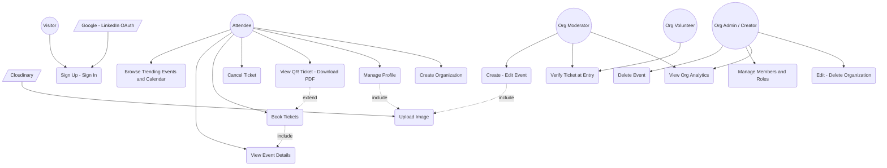
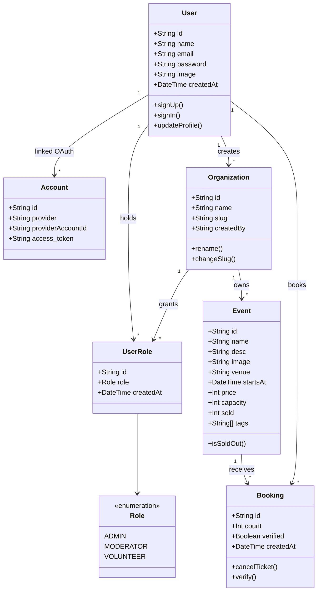
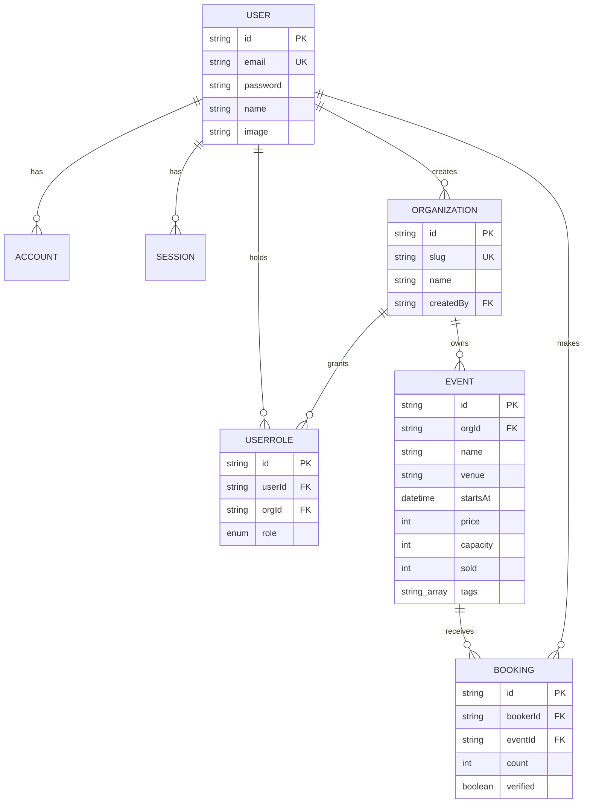
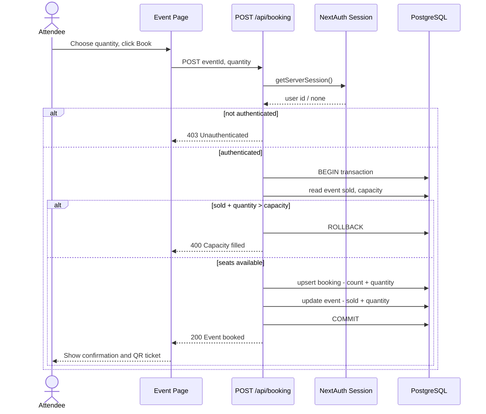
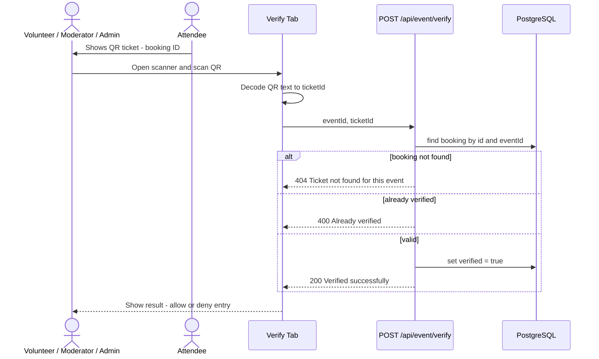
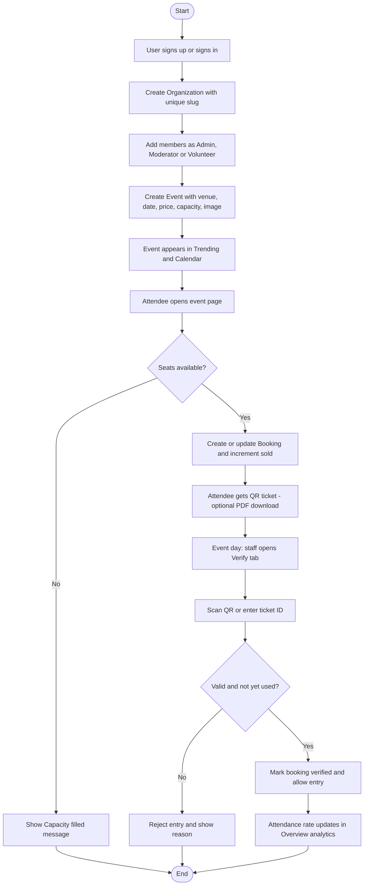
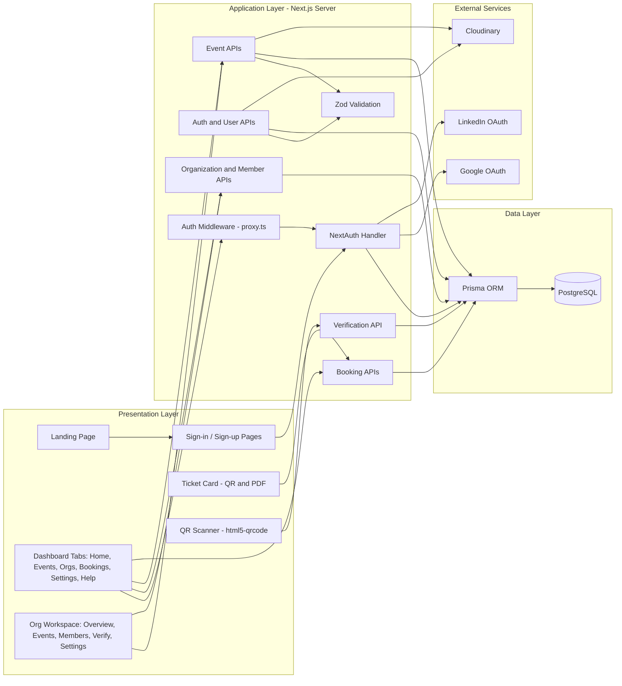
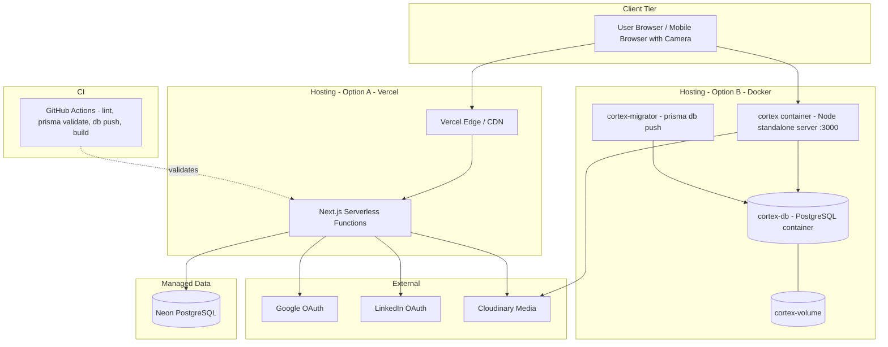

# Software Requirements Specification (SRS)

## Cortex — Multi-Tenant Event Management & Ticketing SaaS Platform

**Document Version:** 1.0
**Standard Reference:** IEEE 29148 / IEEE 830 SRS structure
**Source Repository:** https://github.com/quirbyte/Cortex-v2 (branch `master`)
**Author:** Soumyadip Mondal (@quirbyte)
**Prepared for:** Event organizers, event attendees, and the platform development/operations team

---

## 1. Introduction

### 1.1 Purpose
This document specifies the functional and non-functional requirements for **Cortex**, a multi-tenant web platform that lets organizations create and manage events, sell/book tickets, manage team members with role-based permissions, and verify attendees at the venue using QR codes.

The document describes the system as implemented in the `Cortex-v2` repository and identifies planned enhancements and known gaps (Appendix 5.4) so that it can be used for development, review, testing, and academic/portfolio submission.

### 1.2 Scope
Cortex shall:
- Allow users to register and sign in using email/password, Google OAuth, or LinkedIn OAuth.
- Allow any authenticated user to create **Organizations** (tenants) identified by a unique slug, and to invite other registered users to them with roles (**Admin, Moderator, Volunteer**).
- Allow organization staff to create, edit, and delete **Events** (venue, date/time, price, capacity, tags, banner image).
- Allow attendees to discover events (trending list, event calendar, event pages), **book tickets** with capacity enforcement, and cancel tickets.
- Generate a **QR code per booking**, downloadable as a PDF ticket.
- Allow staff to **verify tickets at entry** by scanning the QR code (camera) or entering the ticket ID, and mark the booking as used to prevent duplicate entry.
- Provide an organization **overview dashboard** (events created, tickets sold, revenue, attendance rate, top events).
- Provide user profile management (display name, avatar), light/dark theme, and a help page.

Out of scope (current release): online payment processing (e.g., Razorpay), wallet/transaction ledger, refunds, email/SMS notifications, AI-based event recommendation (RAG + pgvector), Redis caching, and native mobile applications. These are listed as future work in Section 2.6 and Appendix 5.4.

### 1.3 Intended Audience
- Developer / maintainer of the platform
- Academic reviewers / evaluators and recruiters reviewing the project
- QA / testers
- Event organizers and organization admins (as primary stakeholders)
- DevOps engineers responsible for deployment

### 1.4 Definitions, Acronyms, Abbreviations
| Term | Description |
|---|---|
| SaaS | Software as a Service |
| Multi-tenancy | A single application instance serving multiple isolated organizations |
| Organization (Org) | A tenant; a group that owns events and has members |
| Slug | Unique, URL-friendly identifier of an organization |
| RBAC | Role-Based Access Control |
| Admin | Org role with full control over events, members, and settings |
| Moderator | Org role that can create/edit events (but not delete them or manage the org) |
| Volunteer | Default org role; intended for door staff who verify tickets |
| Booking | A record of one user's ticket purchase for one event (with a ticket count) |
| Verification / Check-in | Marking a booking as used when the attendee enters the venue |
| OAuth | Open standard for delegated authentication (Google, LinkedIn) |
| JWT | JSON Web Token used for session handling |
| ORM | Object-Relational Mapper (Prisma) |
| CI/CD | Continuous Integration / Continuous Deployment |
| NFR / FR | Non-Functional / Functional Requirement |

### 1.5 References
- IEEE 830-1998 / ISO/IEC/IEEE 29148:2018 SRS guidelines
- Cortex-v2 repository: `README.md`, `prisma/schema.prisma`, `app/api/**`, `.github/workflows/ci.yml`, `Dockerfile`, `docker-compose.yml`
- Next.js, NextAuth.js v4, Prisma, Tailwind CSS, Cloudinary, and Zod documentation

### 1.6 Overview
Section 2 gives an overall product description. Section 3 details functional, non-functional, interface, and data requirements. Section 4 provides UML design models (use case, class/ER, sequence, activity, component, deployment). Section 5 contains appendices, including implementation status and known gaps.

---

## 2. Overall Description

### 2.1 Product Perspective
Cortex is a **standalone, full-stack web application** built on Next.js (App Router) with server-side rendering, API route handlers, and a PostgreSQL database accessed via Prisma. It integrates with the following external services:
- **Google and LinkedIn** (OAuth identity providers)
- **Cloudinary** (image storage for event banners and user avatars)
- **PostgreSQL** (Neon in production; containerized Postgres for local/Docker use)
- **Vercel** (hosting) and **GitHub Actions** (CI)

It is a new system. Tenants are isolated logically through the `Organization` entity and the `UserRole` membership table.

### 2.2 Product Functions (Summary)
1. Authentication & session management (credentials, Google, LinkedIn)
2. Organization (tenant) management
3. Team membership & role management
4. Event creation, editing, deletion, and image upload
5. Event discovery (trending events, calendar, event detail pages)
6. Ticket booking and cancellation with capacity enforcement
7. QR ticket generation and PDF download
8. QR-based attendee verification (check-in)
9. Organization analytics overview
10. User profile & settings, theming, and help

### 2.3 User Classes and Characteristics
| User Class | Description | Technical Expertise |
|---|---|---|
| Visitor (unauthenticated) | Views the landing page; can sign up or sign in | Low |
| Attendee (authenticated user) | Browses events, books/cancels tickets, views QR tickets | Low |
| Org Volunteer | Verifies attendee tickets at the venue via scanner | Low |
| Org Moderator | Creates and edits events for the organization | Low–Medium |
| Org Admin | Full control: events, members, org settings, deletion, analytics | Medium |
| Org Creator | The Admin who created the org; cannot leave it, may delete it | Medium |
| System/DevOps Administrator | Deploys, configures environment variables, manages database | High |

> A single user may hold different roles in different organizations and is always an attendee for public events.

### 2.4 Operating Environment
- Server: Node.js (v22 in CI; v24 slim image in Docker), Next.js 16 / React 19, deployed on Vercel or as a Docker container
- Database: PostgreSQL
- Client: Modern browsers (Chrome, Edge, Firefox, Safari — latest 2 versions); camera access required for QR scanning
- Responsive layout for desktop, tablet, and mobile viewports

### 2.5 Design and Implementation Constraints
- Stack: Next.js (App Router), TypeScript, Prisma ORM with `@prisma/adapter-pg`, NextAuth.js v4 (JWT session strategy), Tailwind CSS v4, Zod validation.
- Passwords shall be stored only as bcrypt hashes.
- Uploaded images shall be limited to **2 MB** and the formats **JPEG, PNG, WebP** (avatars additionally restricted to jpg/jpeg/png/webp).
- Unique constraints: user email, organization slug, `(userId, orgId)` on roles, `(bookerId, eventId)` on bookings.
- Secrets (OAuth client secrets, `NEXTAUTH_SECRET`, Cloudinary credentials, `DATABASE_URL`) shall be supplied through environment variables and never committed (`.env.example` documents the keys).
- Protected routes (`/dashboard/**`) are guarded by NextAuth middleware (`proxy.ts`).

### 2.6 Assumptions and Dependencies
- Users have an internet connection; attendees at the venue have a working camera on the verifying device.
- Google/LinkedIn OAuth apps and a Cloudinary account are configured by the deployer.
- A managed or containerized PostgreSQL instance is available.
- A user must already have a registered Cortex account before being added to an organization (members are added by email).
- **Planned/future work:** wallet-based payments and Razorpay integration, Redis caching of event listings, AI-powered recommendations (RAG + pgvector), and server-side per-organization authorization hardening (see Appendix 5.4).

---

## 3. Specific Requirements

### 3.1 Functional Requirements

**FR-1 Authentication & Account Management**
- FR-1.1: The system shall allow a visitor to sign up with name, valid email, and password (validated server-side: name ≥ 6 characters, valid email format, password ≥ 6 characters).
- FR-1.2: The system shall reject sign-up if the email is already registered.
- FR-1.3: The system shall store passwords as bcrypt hashes (salt rounds = 10).
- FR-1.4: The system shall allow sign-in using email/password, Google OAuth, or LinkedIn OAuth (OpenID Connect).
- FR-1.5: The system shall link OAuth sign-ins to an existing account with the same email.
- FR-1.6: The system shall maintain sessions as signed JWTs in an HTTP-only, SameSite=Lax cookie (Secure in production), exposing the user ID and email to the session.
- FR-1.7: The system shall redirect unauthenticated users accessing `/dashboard/**` to the sign-in page.
- FR-1.8: The system shall allow a user to update their display name and upload or remove their avatar image.

**FR-2 Organization (Tenant) Management**
- FR-2.1: An authenticated user shall be able to create an organization with a name (≥ 6 characters) and a unique slug; the creator is automatically assigned the **ADMIN** role.
- FR-2.2: The system shall list all organizations in which the user holds a role, along with the user's role.
- FR-2.3: An Admin shall be able to rename the organization and change its slug.
- FR-2.4: The organization creator shall be able to delete the organization; deletion shall cascade to its roles, events, and bookings.
- FR-2.5: A non-creator member shall be able to leave an organization; the creator shall not be permitted to leave (must delete the org instead).
- FR-2.6: The organization page (`/dashboard/[slug]`) shall be accessible only to users holding a role in that organization.

**FR-3 Team & Role Management**
- FR-3.1: An Admin shall be able to add an existing registered user to the organization by email with a role of ADMIN, MODERATOR, or VOLUNTEER (default VOLUNTEER).
- FR-3.2: The system shall prevent assigning more than one role to the same user within the same organization and shall return a clear conflict message.
- FR-3.3: The system shall return a clear "user not found" message if the email is not registered.
- FR-3.4: An Admin shall be able to remove a member; the creator shall not be removable.
- FR-3.5: The members view shall group members by role (Admins, Moderators, Volunteers).

**FR-4 Event Management**
- FR-4.1: Admins and Moderators shall be able to create an event with name (≥ 3 characters), optional description, venue, start date/time (ISO datetime), price (≥ 0), capacity (positive integer), tags, and an optional banner image.
- FR-4.2: The system shall upload banner images to Cloudinary (folder `organization_events`), validating size (≤ 2 MB) and type (JPEG/PNG/WebP).
- FR-4.3: Admins and Moderators shall be able to edit any event field; replacing a banner shall delete the previous Cloudinary asset.
- FR-4.4: Only Admins shall be able to delete an event; deletion cascades to its bookings.
- FR-4.5: The system shall display per-event ticket sales (`sold` / `capacity`) in the organization's event list.

**FR-5 Event Discovery**
- FR-5.1: The home dashboard shall show **Trending** events — the top 5 events ranked by sold-to-capacity ratio.
- FR-5.2: The home dashboard shall show an **event calendar** of events.
- FR-5.3: The Events tab shall list available events; each event shall have a detail page showing venue, date/time, price, description, tags, and real-time availability.
- FR-5.4: The system shall provide a share action on event pages.
- FR-5.5: A fallback image shall be shown for events without a banner.

**FR-6 Ticket Booking**
- FR-6.1: An authenticated user shall be able to book *n* tickets (n ≥ 1) for an event.
- FR-6.2: The system shall reject a booking if `sold + n > capacity` (overbooking prevention) and respond with a clear message.
- FR-6.3: The booking and the increment of the event's `sold` counter shall execute in a single database transaction.
- FR-6.4: A user shall hold at most one booking record per event; additional bookings of the same event shall increase that record's ticket count.
- FR-6.5: A user shall be able to cancel tickets; each cancellation shall decrement the booking count (deleting the booking when the count reaches zero) and the event's `sold` counter in the same transaction.
- FR-6.6: The "My Bookings" view shall list the user's bookings with event details.

**FR-7 QR Ticket & Verification**
- FR-7.1: The system shall generate a QR code for each booking encoding the booking ID.
- FR-7.2: The user shall be able to download a ticket (event details + QR) as a PDF.
- FR-7.3: Authorized staff shall be able to open a **Verify** tab for an event, scan a QR code with the device camera, or manually enter the ticket ID.
- FR-7.4: On verification the system shall confirm that the ticket exists for the given event; if valid and unused, it shall mark it `verified = true` and return success.
- FR-7.5: The system shall reject a ticket that is not found for the event (404) or has already been verified (duplicate entry).

**FR-8 Organization Analytics**
- FR-8.1: The Overview pane shall display: total events created, total tickets sold, total revenue (Σ sold × price, in INR), and attendance rate (verified check-ins ÷ tickets sold).
- FR-8.2: The Overview pane shall show a ranking/percentage breakdown of events by tickets sold.

**FR-9 User Interface & Settings**
- FR-9.1: The system shall provide a sidebar dashboard with tabs: Home, Events, Organizations, Bookings, Settings, Help.
- FR-9.2: The system shall support dark/light themes with system-preference detection.
- FR-9.3: The system shall provide a public landing page and a Help page (FAQ and support channels).
- FR-9.4: The system shall show loading skeletons while tab data loads.

### 3.2 Role–Permission Matrix (intended behavior)
| Capability | Attendee | Volunteer | Moderator | Admin | Creator |
|---|:-:|:-:|:-:|:-:|:-:|
| Browse events / book / cancel own tickets | ✔ | ✔ | ✔ | ✔ | ✔ |
| Verify tickets (scanner) | ✘ | ✔ | ✔ | ✔ | ✔ |
| Create / edit events | ✘ | ✘ | ✔ | ✔ | ✔ |
| Delete events | ✘ | ✘ | ✘ | ✔ | ✔ |
| Add / remove members, change org name/slug | ✘ | ✘ | ✘ | ✔ | ✔ |
| View org analytics overview | ✘ | ✘ | ✔ | ✔ | ✔ |
| Delete organization | ✘ | ✘ | ✘ | ✘ | ✔ |
| Leave organization | — | ✔ | ✔ | ✔ | ✘ |

### 3.3 Non-Functional Requirements

| ID | Category | Requirement |
|---|---|---|
| NFR-1 | Performance | Page and API responses for typical operations (list, book, verify) shall complete within 2 seconds under normal load; dashboard tabs shall use streaming/Suspense to show content progressively. |
| NFR-2 | Scalability | The application shall be stateless (JWT sessions) to allow horizontal scaling; all foreign keys shall be indexed for query performance. |
| NFR-3 | Availability | Target ≥ 99% uptime on the managed hosting platform (Vercel + managed PostgreSQL). |
| NFR-4 | Data Integrity | Booking and cancellation shall be atomic transactions; the database shall enforce uniqueness and cascade deletes. |
| NFR-5 | Security | Passwords hashed with bcrypt; HTTP-only SameSite cookies; HTTPS in production; secrets only via environment variables; input validated with Zod; Docker image must not contain `.env` files. |
| NFR-6 | Tenant Isolation | Data and actions of one organization shall not be accessible to members of another organization (see gap analysis in Appendix 5.4). |
| NFR-7 | Usability | Responsive UI usable on mobile; a volunteer shall be able to verify a ticket in ≤ 3 interactions (open scanner → scan → confirmation). |
| NFR-8 | Maintainability | Strict TypeScript, ESLint enforced in CI, modular components (`components/`, `sections/`, `app/api/`), and versioned Prisma migrations. |
| NFR-9 | Portability | Deployable on Vercel, or via a multi-stage Docker image / Docker Compose with Postgres on any container host. |
| NFR-10 | Compatibility | Support latest two versions of Chrome, Edge, Firefox, and Safari. |
| NFR-11 | Reproducibility | CI shall validate lint, Prisma schema, DB push, and production build on every push/PR to `main`/`master`. |

### 3.4 External Interface Requirements
- **User Interfaces:** Landing page; sign-in/sign-up; dashboard (Home, Events, Organizations, Bookings, Settings, Help); organization workspace (Overview, Events, Members, Verify, Settings); event detail page; ticket modal with QR.
- **Hardware Interfaces:** Device camera (via browser) for QR scanning.
- **Software Interfaces:**
  - NextAuth.js providers: Credentials, Google, LinkedIn
  - Cloudinary Upload/Destroy API (images)
  - PostgreSQL via Prisma (`@prisma/adapter-pg`)
- **Communication Interfaces:** HTTPS/JSON REST endpoints and `multipart/form-data` for image uploads.

**REST API Summary**

| Endpoint | Method | Purpose |
|---|---|---|
| `/api/auth/[...nextauth]` | GET/POST | NextAuth sign-in, callbacks, session |
| `/api/auth/signup` | POST | Register a user (credentials) |
| `/api/user` | PUT | Update display name |
| `/api/user` | PATCH | Upload / delete avatar |
| `/api/orgs` | POST | Create organization (creator becomes ADMIN) |
| `/api/orgs` | PUT / PATCH | Update slug / update name |
| `/api/orgs` | DELETE | Delete organization (creator only) |
| `/api/orgs/members` | POST | Add member by email + role |
| `/api/orgs/members` | DELETE | Remove member |
| `/api/orgs/members` | PATCH | Leave organization |
| `/api/event` | POST | Create event (multipart, optional image) |
| `/api/event` | PUT | Update event |
| `/api/event` | DELETE | Delete event |
| `/api/event/verify` | POST | Verify ticket (`eventId`, `ticketId`) |
| `/api/booking` | POST | Book tickets (`eventId`, `quantity`) |
| `/api/booking` | DELETE | Cancel one ticket of a booking |

### 3.5 Data Requirements
Core entities (PostgreSQL via Prisma):
- **User** — id, name, email (unique), hashed password (nullable for OAuth users), image, timestamps.
- **Account / Session / VerificationRequest** — NextAuth adapter tables (OAuth provider accounts, sessions, verification tokens).
- **Organization** — id, name, slug (unique), createdBy (→ User), timestamps.
- **UserRole** — userId, orgId, role (`ADMIN | MODERATOR | VOLUNTEER`, default `VOLUNTEER`); unique on `(userId, orgId)`.
- **Event** — id, name, desc, image, venue, startsAt, price (Int, INR), capacity, sold (default 0), tags (String[]), orgId.
- **Booking** — id, bookerId, eventId, count (default 1), verified (default false), timestamps; unique on `(bookerId, eventId)`.
- Referential actions: cascade deletes from User/Organization/Event to dependent records; indexes on `orgId`, `eventId`, and `createdBy`.
- Media: images stored in Cloudinary under `organization_events` and `user_avatars`; only the resulting URL is stored in the database.
- Schema evolution: tracked through Prisma migrations (`prisma/migrations`).

---

## 4. UML Design Models

### 4.1 Use Case Diagram

### 4.2 Class Diagram

### 4.3 Entity-Relationship Diagram

### 4.4 Sequence Diagram — Ticket Booking

### 4.5 Sequence Diagram — QR Verification at Entry

### 4.6 Activity Diagram — Event Lifecycle (Organizer to Entry)

### 4.7 Component Diagram

### 4.8 Deployment Diagram

---

## 5. Appendix

### 5.1 Technology Stack
| Layer | Technology |
|---|---|
| Framework | Next.js (App Router), React 19 |
| Language | TypeScript |
| Authentication | NextAuth.js v4 (JWT strategy; Credentials, Google, LinkedIn) |
| Database / ORM | PostgreSQL (Neon in production), Prisma 7 with `@prisma/adapter-pg` |
| Validation | Zod |
| Styling / UI | Tailwind CSS v4, Motion, lucide-react, next-themes |
| QR & Tickets | `qrcode.react`, `html5-qrcode`, `html-to-image`, `jspdf` |
| Media | Cloudinary (via `sharp`-assisted uploads) |
| DevOps | Docker (multi-stage), Docker Compose, GitHub Actions, Vercel |

### 5.2 Key Performance Indicators (for validation)
- Booking success rate and zero overbooking incidents (`sold ≤ capacity` invariant)
- Median API latency for booking and verification calls
- Duplicate-entry rejection rate at verification
- Attendance rate (verified ÷ sold) per event/organization
- CI pass rate and build time

### 5.3 Test Scenarios (acceptance criteria summary)
| ID | Scenario | Expected Result |
|---|---|---|
| T-1 | Sign up with an already-registered email | Rejected with "User already exists" |
| T-2 | Create org with duplicate slug | Rejected (unique constraint) |
| T-3 | Add the same user twice to an org | 409 conflict message |
| T-4 | Book tickets exceeding remaining capacity | 400 "Capacity filled", no data changed |
| T-5 | Two concurrent bookings for the last seat | At most one succeeds (transactional integrity — see 5.4) |
| T-6 | Cancel a booking with count = 1 | Booking deleted, `sold` decremented |
| T-7 | Verify a valid ticket | Booking marked verified |
| T-8 | Verify the same ticket twice | Second attempt rejected as already verified |
| T-9 | Verify a ticket from a different event | 404 not found for this event |
| T-10 | Unauthenticated access to `/dashboard` | Redirect to sign-in |
| T-11 | Upload a 3 MB or non-image banner | Rejected with validation message |

### 5.4 Implementation Status and Known Gaps
This appendix is included for transparency; it records where the current code (as of this SRS) does not yet fully satisfy the requirements above, and is intended as a hardening backlog.

**A. Authorization (highest priority)**
- The role-permission matrix (3.2) is enforced mainly in the **UI** (buttons hidden by role). Several API handlers do not verify the session or the caller's role/org membership server-side: `/api/event` (POST/PUT/DELETE), `/api/event/verify`, `/api/orgs/members` (POST/DELETE/PATCH), `/api/orgs` (PUT/PATCH), and `/api/user` (PUT/PATCH, which accept `userId`/`id` from the request body). Until fixed, NFR-6 (tenant isolation) and FR-3/FR-4/FR-7 role rules are not guaranteed at the API level.
- `proxy.ts` only protects `/dashboard/**` pages; `/api/**` routes are not covered by it.
- `allowDangerousEmailAccountLinking` is enabled for Google and LinkedIn, which links accounts by email without additional verification.

**B. Data/Logic Issues**
- Concurrent bookings: the capacity check and increment are in one transaction, but under default isolation two simultaneous requests can still both pass the check; an atomic conditional update (`sold + n <= capacity`) or row lock is recommended.
- `DELETE /api/booking` decrements `sold` by 1 per call, consistent with its "cancel one ticket" behavior; a bulk-cancel/refund flow is not defined.
- Sign-up validation failure returns an HTTP 200 body instead of a 4xx status; the validation messages for `name` (≥ 6 characters) may be stricter than intended for real names.
- `PUT/PATCH /api/orgs` check `isValidated` (an object, always truthy) instead of `isValidated.success`, so invalid slug/name values are not rejected.

**C. Documentation vs. Code**
- The README lists wallet, balance, and transaction features; the current schema contains **no Wallet/Transaction models** and booking does not deduct funds. Ticket `price` is used only for revenue reporting. Payments are therefore out of scope for this version.
- The README states Next.js 15 while `package.json` pins Next.js 16.x and React 19; this SRS follows `package.json`.
- The README states "every database query is scoped by `orgId`" and "middleware enforces role permissions at route level"; see item A for the current state.
- The QR code encodes the booking ID (not a separate `qrCode` field as described in the README).

**D. Planned Features (not yet implemented)**
- Wallet and Razorpay payment integration
- Redis caching of event listings
- AI-powered event recommendations (RAG + pgvector)
- Email/SMS ticket delivery and event reminders
- Refund workflow and organizer payouts

### 5.5 Sample Environment Variables
`DATABASE_URL`, `NEXTAUTH_URL`, `NEXTAUTH_SECRET`, `GOOGLE_CLIENT_ID`, `GOOGLE_CLIENT_SECRET`, `LINKEDIN_CLIENT_ID`, `LINKEDIN_CLIENT_SECRET`, `CLOUDINARY_CLOUD_NAME`, `CLOUDINARY_API_KEY`, `CLOUDINARY_API_SECRET`, `NEXT_PUBLIC_CLOUDINARY_CLOUD_NAME`.

---

*End of Document*
